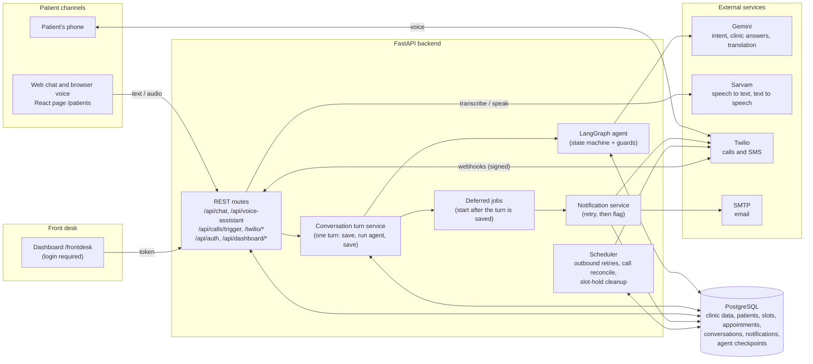
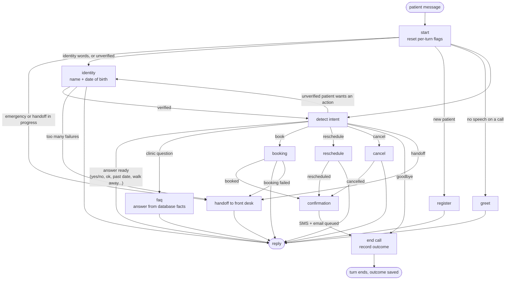
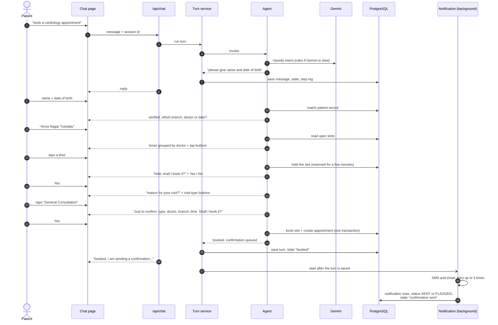
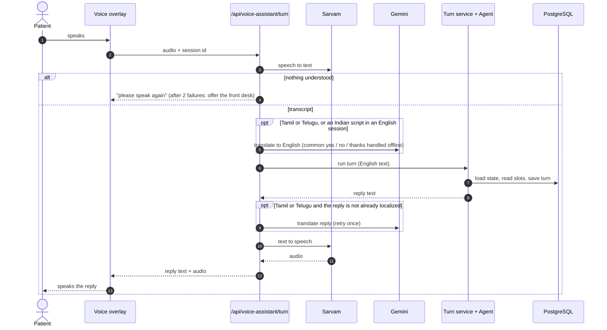
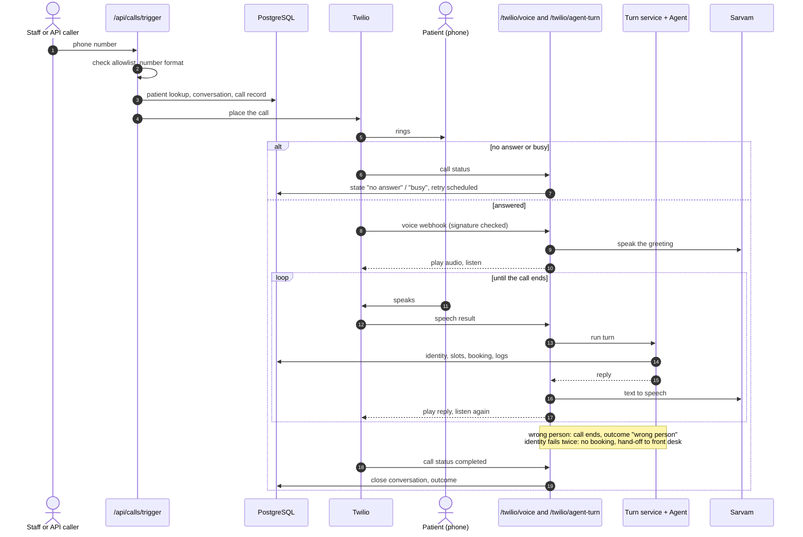
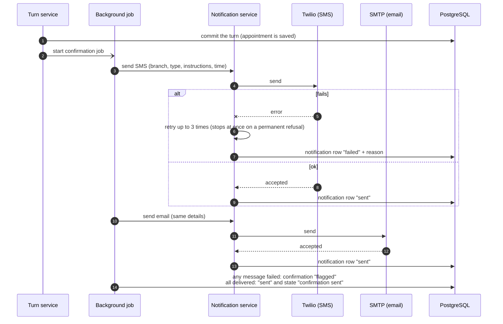
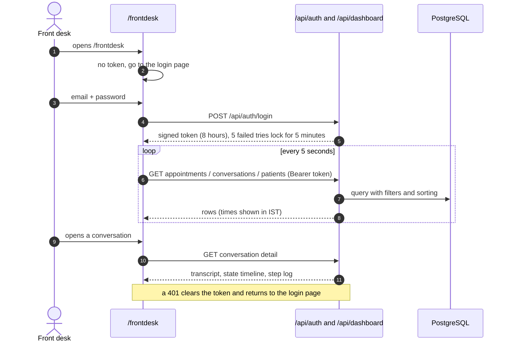

# iClinic - Architecture and sequence diagrams

The diagrams are written in Mermaid. They show as pictures on GitHub, and in VS Code with the "Markdown Preview Mermaid
Support" extension (or any Mermaid viewer).

## 1. System architecture

**Reading it:** every channel ends up in the same turn service and the same agent, so chat, voice and calls share one set
of booking rules. The database is the only source of doctors, branches and slots; nothing about the clinic is hard-coded.

## 2. Inside the agent (one patient message)

Between turns the agent's state (identity, held slot, chosen doctor and date, what it is waiting for) is kept in the
database, so each message continues where the last one stopped.

## 3. Sequence: booking in the web chat

## 4. Sequence: one voice turn (browser voice assistant)

## 5. Sequence: AI outbound call

## 6. Sequence: confirmation delivery and the failure path

## 7. Sequence: front desk dashboard

